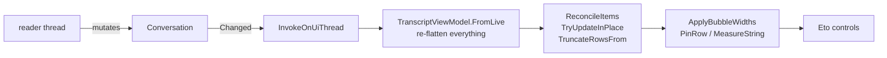
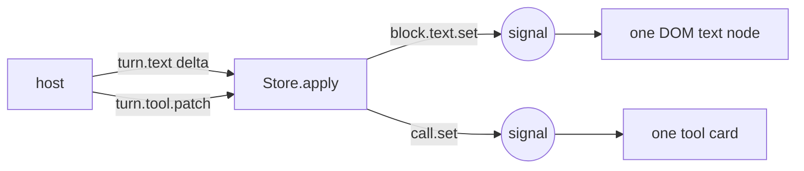

# AI panel

The Rhino AI panel as a webview-hosted TypeScript app. It replaces the Eto panel in `rhino/plugin/UI/AIPanel.cs`.

No runtime dependencies: no framework, CSS library, markdown package, or highlighter. Dev dependencies are esbuild and TypeScript, plus optional `puppeteer-core` for browser checks.

It also runs against a scripted mock host, so you can work on it in a browser without Rhino.

## Commands

```sh
npm install
npm run dev          # watch + dev server on :5173
npm run build        # dist/panel.{js,css}, dist/panel.html (self-contained), dist/panel.host.html, dist/artifact.html
npm run typecheck
npm test             # unit tests for the pure layers (node --test)
npm run verify       # black-box checks in a real browser
npm run verify:shots # same, with screenshots
```

Open `dist/panel.html`. Under the mock host it adds review chrome: width presets (264 / 340 / 460 / full), a drag handle, and a light/dark switch, so you can judge it at docked-panel widths. That chrome never appears with a native host.

The plug-in embeds `dist/panel.host.html` as the `Rhino.AI.panel.html` resource. Rebuild the panel before building the plug-in if you changed it.

## Design: deltas, not snapshots

The Eto panel subscribed to `Conversation.Changed`, re-read the whole conversation graph, flattened it into rows, and diffed those rows against what it had already drawn:



Here the host says what changed, and a signal sits on each text block:



`turn.text` names the block it extends. `turn.tool.patch` names the call it completes. A full `conversation` snapshot is sent only on load, resume, and reconnect. Nothing re-flattens or re-diffs, no row is rebuilt, and no width is measured.

## Layout

```
src/
  core/       signal.ts      ~90 lines of signals: signal / computed / effect / untrack
              dom.ts         declarative elements, scoped effects, keyed list reconciler
              markdown.ts    markdown -> DOM (never an HTML string, so model text cannot inject)
              highlight.ts   tokenizer for python / c# / js / json
  protocol/   events.ts      the panel <-> host wire protocol, one discriminated union each way
              bridge.ts      WebView2 | WKWebView | mock, behind one interface
              mockHost.ts    scripted Rhino: five scenarios, real event ordering
              viewport.ts    a fake viewport capture as an SVG data URI
  state/      store.ts       host state as signals, down to the streaming text block
              ui.ts          view-only state (draft, overlays, expanded cards, scroll pin)
              format.ts      time / tokens / cost / duration / bytes
              tools.ts       tool name -> family -> icon
  ui/         app header transcript message toolCard previews question composer
              history empty notices agentMenu icons context
  i18n/       strings
  dev/        frame.ts       review chrome, mock host only
  styles/     panel.css      design tokens, light + dark, container queries
tools/        verify.mjs     black-box browser checks
```

## Features

- **Markdown with highlighted code:** headings, lists, tables, blockquotes, inline code, and fenced code with a language label and copy button.
- **Tool results rendered as what they are:** captures show the image inline, layer listings show a table, selections show a clickable object list that reveals in the viewport, solves show component and diagnostic chips. Raw JSON is one click away, highlighted.
- **`@` context:** mention the selection, a layer, the active view, the document, or the open Grasshopper file, and it goes with the prompt as a chip.
- **`/` commands** in the composer: new, history, agent, stop, settings.
- **Per-turn revert,** using `TurnUndoCheckpoint` (each turn is one undo record).
- **Plan strip** for agents that emit a plan.
- **Searchable history** drawer.
- **Agent switching** that shows why an agent is unavailable.
- **Scroll pinning:** follows the tail until you scroll away, then shows a "New output" pill while a turn is running.
- **Drag-and-drop and pasted attachments** with thumbnails.
- **Accessibility:** focus rings, `aria-live` on streaming text, labelled controls, real radio groups.
- **Responsive** down to ~250px via container queries, and usable floated wide.

## Host bridge

The C# side lives in `rhino/plugin/UI` (`AIPanel`, `AIPanelViewModel`, `PanelBridge`, `PanelEvents`, `PanelContextSource`). The contract:

- The host serialises `HostEvent` to the view (`window.rhinoAI.receive(...)`) and deserialises `PanelCommand` from it. `bridge.ts` accepts both WebView2's message channel and WKWebView's `messageHandlers.rhinoAI`.
- `Conversation` mutations go out as incremental events, not a bare `Changed`.
- Tool phrasing is authored host-side, where the real arguments are (`ToolCall.title`).
- A context source answers `@` mentions and handles `context.reveal` (select and zoom).

Agent hosting below the bridge (`AgentHost`, `AgentDispatch`, `AgentRegistry`, `ConversationStore`, `TurnUndoCheckpoint`) is unchanged by the panel. Protocol changes need both sides updated in the same PR.

## Engine floor

The panel renders in the OS WebView, so the requirement is an engine version, not a dependency.

| | Minimum OS | Engine | Verdict |
| --- | --- | --- | --- |
| Rhino 9 | macOS 15.0 / WebView2 evergreen | WebKit 18+ / Chromium | fine |
| Rhino 8 | macOS 12.4 / WebView2 evergreen | WebKit 15.5 shipped, updates with Safari | supported, see below |

Rhino 8 ships WebView2 on Windows, and its bundled Eto has the same `WebView.MessageReceived` channel and `window.eto.postMessage` shim as Rhino 9, so interop is identical across versions.

The real constraint is macOS WebKit, since WKWebView tracks the installed Safari. To keep Rhino 8 working:

- **No `color-mix()`.** Every blended colour is a plain token per theme.
- **Container queries are probed at startup** (`CSS.supports('(container-type: inline-size)')`). If unsupported, the panel shows an "update your OS" notice with a **Show it anyway** override instead of rendering a broken layout.

The plug-in is Apple Silicon only, and every Apple Silicon Mac can run a current macOS, so an old WebKit is a pending update, not a hardware limit.

Keep both rules when contributing CSS.

## Why replace the Eto panel

| Eto code | Replaced by |
| --- | --- |
| `TranscriptViewModel` | Host emits blocks directly; nothing to flatten |
| `ReconcileItems` / `TryUpdateInPlace` / `TruncateRowsFrom` / `RenderedRow` | One keyed `each` in `dom.ts` |
| `MessageBubble` | CSS |
| `TextMeasure`, `ApplyBubbleWidths`, `PinRow`, `LastBudget`, `ScrollbarGuard` | Browser text wrapping; `scrollbar-gutter: stable` |
| `MessageMeta` height reservation | `opacity` on hover |
| `LoadIcon` / `IconCache` / `HexColor` / SVG recolouring | Inline SVG stroked in `currentColor` |
| `ScrollToBottom` + `AsyncInvoke` retry | A `ResizeObserver` on the content |
| `Populating` re-entrancy guard | One-way state flow |
| `ToolSummary` per-tool switch | Phrasing authored host-side |
| `Reconcilable`, `QuestionRow` slot bookkeeping | Regions own their own DOM |

Total line count is similar, not smaller. About 900 lines of TypeScript are `src/core` (signals, DOM layer, markdown, highlighter), which had no C# equivalent. The panel logic itself (`src/ui` + `src/state`) is slightly smaller than the Eto code it replaced and does more.

## Known gaps

- Settings is still an Eto options page; only the panel moved.
- Mock host replies are scripted. Streaming, ordering, cancellation, and the question round-trip are real; the text is not.
- `markdown.ts` is a subset: no footnotes, no nested blockquotes, no HTML passthrough (on purpose).
- No virtualised transcript. Very long conversations hold a lot of DOM; worth measuring before it matters.
